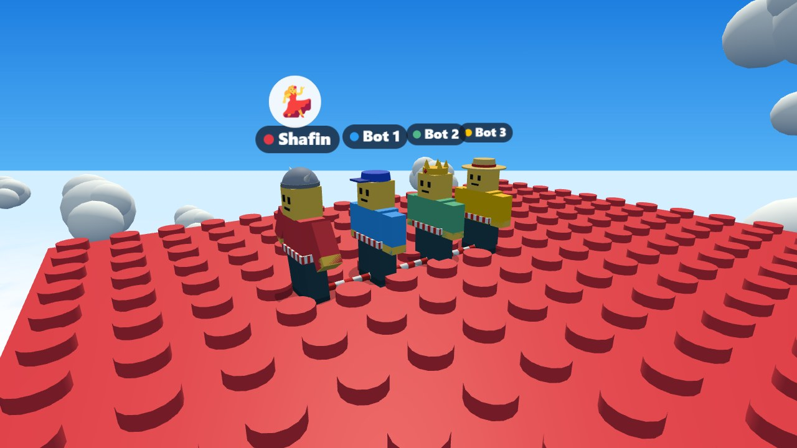
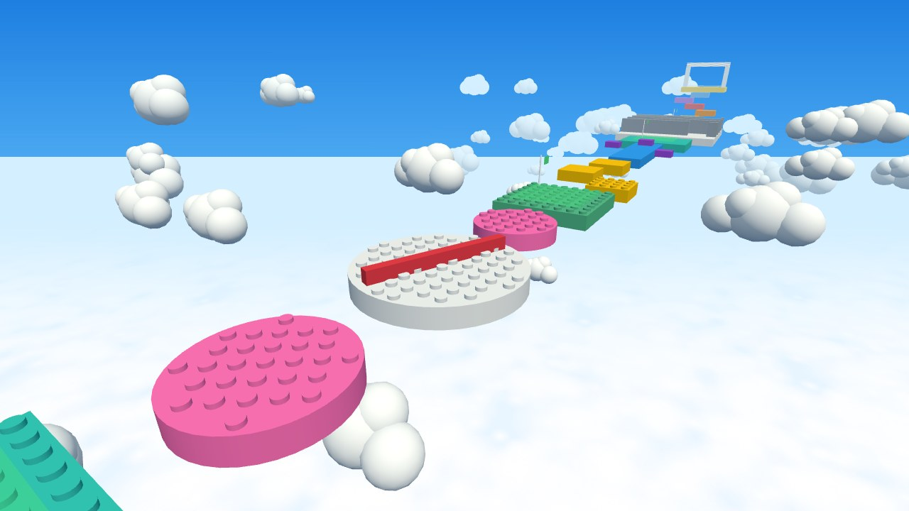
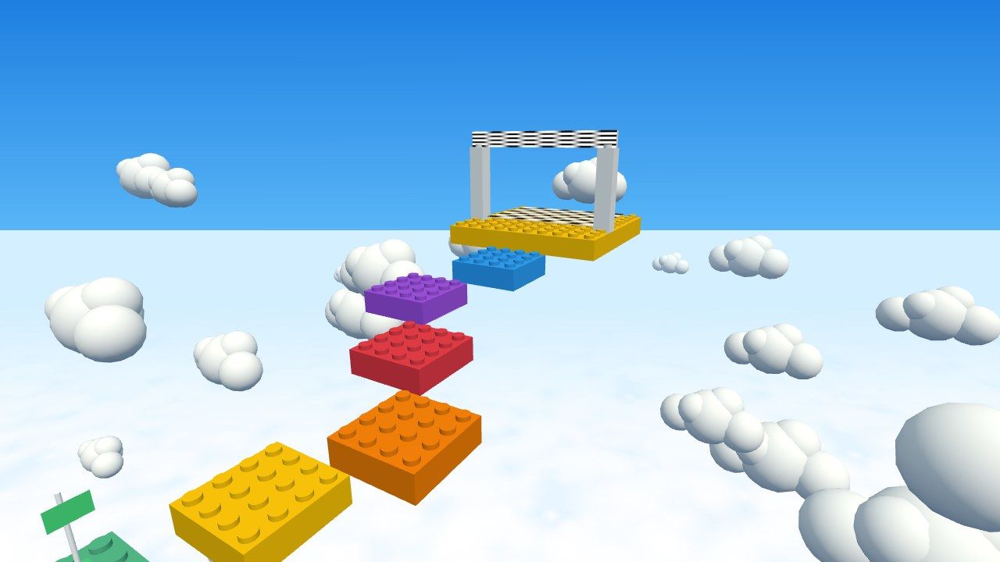
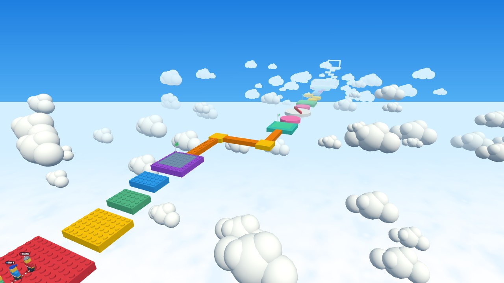

# 🪢 Knot Alone

**Tied together. Never alone.**

A free, open-source 3D party game for **2–6 friends** that runs in your **phone or computer browser**. Everyone is tied together with ropes and has to run, jump, swing, climb and drag each other across a toy-brick obstacle course floating in the sky. If one of you falls… you'll all feel it. 😅

You host it **on your own computer**. Friends join **from anywhere in the world** by tapping a link — no app, no account, no money.



## ✨ What's in it

- 🪢 **A real rope.** It sags, drapes over edges, lies on the floor, wraps around walls and gets dragged by moving blocks. Catch a falling friend, pull them back up, or climb up yourself.
- 🧱 **The Sky Course** — 6 sections: warm-up jumps, thin zig-zag bridges, spinning discs with a sweeper bar, sliding stones and pusher blocks, a brick maze, and a tower climb to the finish.
- 👥 **Rope modes:** one big chain, teams of 3, or teams of 2 racing on the same path (bump into rivals and punch them off bridges 😈).
- 🎭 **Fun actions:** wave 👋, dance 💃, cheer 🎉, punch 👊 (a small shove) and kick 🦵 (a big shove).
- 🧍 **Blocky characters** with your name above your head, 8 shirt colors and 10 hats (Viking helmet, propeller cap, crown…).
- 🤖 **Robot buddies** to fill empty spots — or to test it alone.
- 🏁 Checkpoints, a 3-2-1-GO countdown, a race timer, results with medals, sounds and confetti.
- 📱 Works on phones (joystick + buttons) and computers (keyboard + mouse).

| Spinning discs and the sweeper | The tower climb to the finish |
|---|---|
|  |  |



## 🎮 Host a game night in 3 steps

You need a computer (Windows, Mac or Linux) with **[Node.js](https://nodejs.org) 20 or newer** installed.

**1. Download the game** (once):

```bash
git clone https://github.com/theshafinahmed/knot-alone.git
cd knot-alone
npm install
```

**2. Start it:**

```bash
npm start
```

**3. Share the link.** After about 30 seconds the computer shows a link like `https://some-funny-words.trycloudflare.com` **and a QR code**.
- Scan the QR code with your phone camera, or send the link to friends (WhatsApp, Discord…).
- **Join from your phone first** — the first person to join is the **host** 👑 (picks the rope mode, adds bots, presses Start).
- There's also a 📨 **Invite** button in the lobby with the same link and QR code.

That's it! Keep the computer **on and awake** while you play (plugged in, sleep turned off).

> **Only playing on the same Wi-Fi?** Use `npm run start:local` (no internet link — just the Wi-Fi address and QR code).

## 🕹️ Controls

| | Phone | Computer |
|---|---|---|
| Move | Movement circle (bottom-left) | W A S D / arrow keys |
| Look around | Swipe anywhere else | Mouse (click the game first, Esc to free the mouse) |
| Jump | ⤒ button | Space |
| Climb up the rope (while hanging) | Tap ⤒ again and again | Tap Space |
| Pull a hanging friend up (stand still on solid ground) | Hold the 🪢 button | Hold E |
| Punch 👊 | Punch button | F or click |
| Kick 🦵 (bigger shove, slower) | Kick button | G |
| Wave / Dance / Cheer | 😀 button → pick one | 1 / 2 / 3 |

## ❓ Questions

**Is it really free?** Yes. The game is free and open source, and the internet link uses Cloudflare's free *Quick Tunnel* (no account needed). Note that Cloudflare offers these free tunnels for trying things out, with no promise they'll always be available — if that ever changes, Wi-Fi play (`npm run start:local`) keeps working.

**The link says "site can't be reached".** Brand-new links take up to a minute to work everywhere. Wait a moment and try again, or try on mobile data.

**My phone can't open the Wi-Fi address.** Your computer's firewall may be blocking it. On Windows, allow Node.js on **private networks** when it asks.

**It says "door 3000 is already in use".** The game is already running in another window. Close that one first (Ctrl+C).

**The link changed!** It's a new link every time you start the server. Just share the new one.

**How many players?** Up to 6 (people + robot buddies).

## 🛠️ How it works (for the curious)

- Your computer is the **boss**: it runs the game's physics ([Rapier](https://rapier.rs)) 60 times a second. Phones only send their button presses and draw what the boss says (with [Three.js](https://threejs.org)), so everyone always sees the same thing.
- The rope is a chain of little links that bump into bricks — that's what lets it drape, wrap and get pushed.
- [Cloudflare Quick Tunnel](https://developers.cloudflare.com/cloudflare-one/connections/connect-networks/do-more-with-tunnels/trycloudflare/) gives your computer a public link, so friends behind other routers can reach it.
- Built with TypeScript, Node.js, [ws](https://github.com/websockets/ws), Three.js, Rapier and [Vite](https://vite.dev).

```
client/   the game page (drawing, controls, screens, sounds)
server/   the boss (game room, tunnel, sending the page)
shared/   used by both (physics, rope, course layout, messages)
docs/     plans, design, decisions and progress notes
```

Want to change the course? It's all in [`shared/sky-course.ts`](shared/sky-course.ts) — every brick is one line. More details in [`docs/`](docs/): [game design](docs/GAME_DESIGN.md), [tech plan](docs/TECH_PLAN.md), [decisions](docs/DECISIONS.md).

## 📜 License

[MIT](LICENSE) © 2026 Shafin Ahmed — use it, change it, share it. Have fun, and don't let go of the rope. 🪢
